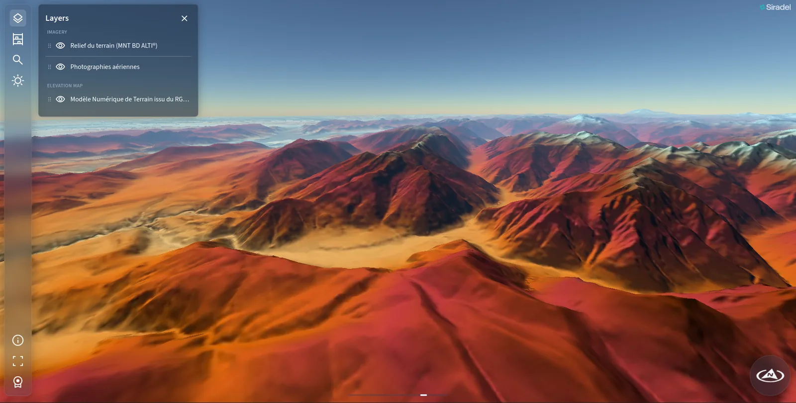

# IGN Explorer — the IGN Géoplateforme catalogue on a 3D globe

An experimental **3D web viewer for the IGN Géoplateforme open data catalogue**,
in English and French. Browse the public WMTS, WMS and vector tile services of the
French national mapping agency and stack them on a 3D globe, right in the browser.

[](https://siradel-oss.github.io/horizon-demo-ign-geoplateforme/)

**[▶ Live demo](https://siradel-oss.github.io/horizon-demo-ign-geoplateforme/)**

## Features

- Browse and search the IGN Géoplateforme catalogues: aerial imagery
  (orthophotos), maps, elevation models, vector tiles
- Add WMTS, WMS and TMS layers to a 3D globe, reorder them and change their opacity
  and style
- OpenStreetMap vector tiles as a base map
- Address search through the Géoplateforme geocoding service
- Lighting and sun position controls
- Per-layer attributions, English / French interface

## Built with Horizon

IGN Explorer is a demo of [Horizon](https://github.com/siradel-oss/horizon), Siradel's
open source real-time 3D engine for map data on a globe (WebAssembly, WebGL 2,
TypeScript). It shows how an application streams and combines third-party raster
and vector services in Horizon.

- Horizon: [website and documentation](https://horizon.oss.siradel.com) ·
  [getting started](https://horizon.oss.siradel.com/doc/getting_started.html) ·
  npm packages `@siradel-oss/horizon-{api,core,protocol}`
- More Horizon demos:
  [Reunion Island Explorer](https://github.com/siradel-oss/horizon-demo-reunion-island)
  (3D hiking trails of La Réunion) ·
  [Shoreline Explorer](https://github.com/siradel-oss/horizon-demo-coastline-erosion)
  (coastal erosion in France)

> **A demonstrator.** Horizon grew out of the [SCE](https://sce.oss.siradel.com)
> ecosystem. IGN Explorer is still an experiment: layers are shown as published,
> without validation, and the rendering may contain small errors.
>
> IGN Explorer is **not an official IGN product**. It is neither affiliated with
> nor endorsed by the Institut national de l'information géographique et
> forestière, and only uses the public services of the Géoplateforme.

## En français

IGN Explorer est une visionneuse 3D expérimentale du catalogue de données ouvertes
de la **Géoplateforme de l'IGN** : orthophotos, cartes, modèles numériques de
terrain et tuiles vectorielles (flux WMTS, WMS) sur un globe 3D, avec recherche
d'adresse. Démonstrateur du moteur 3D open source Horizon, interface en français
et en anglais.

## Run it

Requirements: Node.js ≥ 22.12, pnpm 11 (see `packageManager`), and a browser with WebGL 2 and
`SharedArrayBuffer`.

```bash
pnpm install
pnpm dev        # http://localhost:5173
```

| Command        | Description                              |
| -------------- | ---------------------------------------- |
| `pnpm dev`     | Development server                       |
| `pnpm build`   | Type check and static build into `dist/` |
| `pnpm preview` | Serves the build locally                 |
| `pnpm format`  | Formats the sources with Prettier        |

The build uses relative URLs (Vite base `./`), so `dist/` can be served under any
subpath. `?lang=en` or `?lang=fr` forces the interface language.

### Serving requirements

Horizon runs its WASM core across threads, which requires `SharedArrayBuffer`.
The static server must therefore send these headers on every response:

```
Cross-Origin-Opener-Policy: same-origin
Cross-Origin-Embedder-Policy: require-corp
```

It must also serve `hrz_core.wasm` as `application/wasm`. The dev and preview
servers already do both (see `vite.config.ts`).

Hosts that cannot set headers, such as GitHub Pages, rely on the bundled
[coi-serviceworker](https://github.com/gzuidhof/coi-serviceworker) (MIT), which adds
them client-side. The `.github/workflows/deploy.yml` workflow builds and publishes
the app to GitHub Pages on every push to `main`.

## Stack

- [Horizon](https://horizon.oss.siradel.com): `@siradel-oss/horizon-{api,core,protocol}`
- Vue 3, vue-i18n, Tailwind CSS 4, MiniSearch; Vite and TypeScript

```
src/
├── App.vue           # Horizon canvas, tool rail, windows
├── layout/           # Windows: layers, catalogue, search, lighting, attributions, about
├── components/       # UI primitives
├── service/          # Horizon messages, IGN catalogue and geocoding, layer models
└── locales/          # EN / FR strings
resources/            # Fonts, their licences, compass
```

## Data

No data is bundled: everything is streamed at runtime from public services.

| Source                                                                                             | Content                                      | Licence                                                                                                                              |
| -------------------------------------------------------------------------------------------------- | -------------------------------------------- | ------------------------------------------------------------------------------------------------------------------------------------ |
| [IGN Géoplateforme](https://geoservices.ign.fr/)                                                   | WMTS, WMS and TMS catalogues, address search | Each layer keeps the licence of its producer, mostly [Licence Ouverte 2.0](https://www.etalab.gouv.fr/licence-ouverte-open-licence/) |
| [OpenMapTiles](https://openmaptiles.org/) served by the DINUM on data.gouv.fr (not an IGN service) | OpenStreetMap vector tiles                   | © DINUM, © OpenMapTiles, © [OpenStreetMap](https://www.openstreetmap.org/copyright) contributors (ODbL)                              |

The in-app **Attributions** panel lists the credits of the layers on screen.

## License

Code: [MIT](LICENSE). Data keeps the licence of its producer (see above).
Bundled fonts: Source Sans 3 (SIL Open Font License) and Material Symbols
(Apache License 2.0). Their licence files are in `resources/`.

## Contact

Siradel open source: [opensource@siradel.com](mailto:opensource@siradel.com) ·
[www.siradel.com](https://www.siradel.com)
